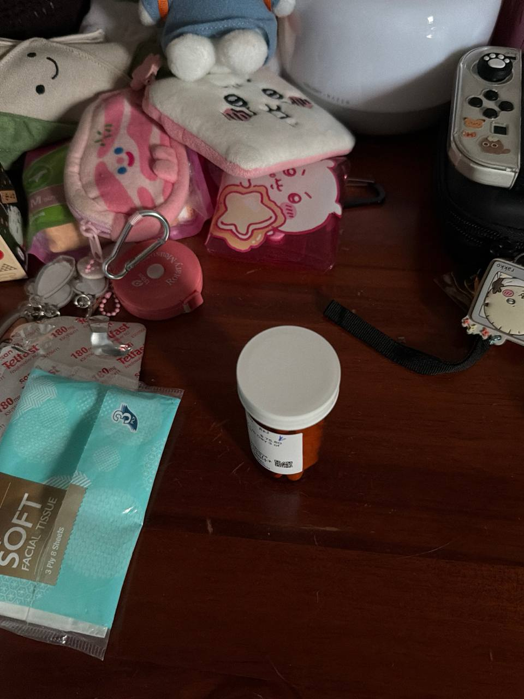
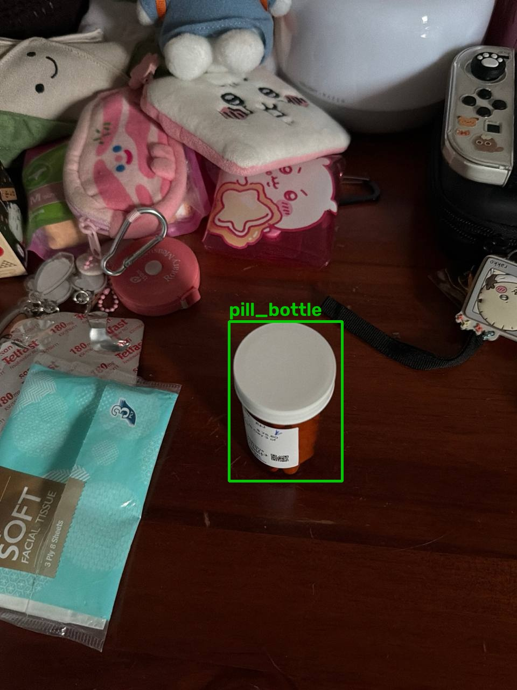

# Child Safety Monitor

A team computer-vision prototype combining hazard detection, a person reference, relative-depth/spatial analysis, a Streamlit interface and Telegram caregiver alerts.

## Project overview

Young children explore by touching and mouthing objects. Button batteries, coins, small toys, medicines and sharp tools are common household items that can cause choking, poisoning or injury. Caregivers can't watch a child every second.

This project is a prototype monitoring assistant. It watches a camera feed, image or video and:

1. **Detects household hazards** with a custom-trained YOLOv8 model (seven hazard groups).
2. **Detects people** with a stock COCO person detector, used as the reference point for proximity. For demo purposes, any detected person stands in for the child.
3. **Estimates relative depth** with Depth Anything V2 Small to tell whether a hazard is at roughly the same depth as the person or far behind or in front of them.
4. **Scores spatial risk** from the image-plane gap, the depth gap and the hazard type, then shows a SAFE, CAUTION, WARNING or CRITICAL level in a Streamlit dashboard.
5. **Alerts caregivers** through Telegram when risk stays high, with duration and cooldown controls to limit repeated messages.

## Team and Contributions

**Team:** AAI3001 — Lab P1, Group 1

| Team Member | Admin Number | Contribution |
|:---:|:---:|:---|
| Ee Chew Fong Olivia | 2102743 | Streamlit interface, camera and image/video testing, Telegram alerts and application integration |
| Thet Htar San | 2502046 | Streamlit interface, camera and image/video testing, Telegram alerts and application integration |
| Teng Tze Hui | 2502437 | Dataset preparation, annotation validation, augmentation, model training, experiment evaluation and model-results documentation |
| Fujita Ayumi | 2502515 | Spatial analysis, proximity calculations, risk scoring and spatial integration |
| Low Yi Hang Nicholas | 2500831 | Spatial analysis, proximity calculations, risk scoring and spatial integration |

**Shared contributions:** system integration, testing, project discussions, README, report and slides review.

## Documentation

| Guide | What it covers |
|:---:|:---|
| [UI and application guide](docs/UI_GUIDE.md) | Installation, camera controls, image/video testing, spatial/depth integration, Telegram and deployment |
| [Model experiments, results and limitations](docs/MODEL_RESULTS.md) | Baseline and six experiments, evaluation protocol, selected configuration, findings, limitations, future work and artifact records |
| [Spatial analysis and integration](docs/SPATIAL_ANALYSIS.md) | Relative box distance, depth sampling, risk formula, temporal handling, tests and seven-class integration gap |
| [Executed notebook](Child_Safety_Hazard_Detection_YOLOv8.ipynb) | Full preparation/training/evaluation code and recorded outputs |

> **Reading the report on GitHub:** the executed notebook is approximately 38 MB and may be too large for GitHub's notebook preview. The [model guide](docs/MODEL_RESULTS.md) is written to stand alone, with readable result tables and figures. Download the notebook and open it in Jupyter or VS Code if you need the full executed cells.

## Dataset

### How the dataset was built

The hazard dataset combines **public online images** and **photographs the team took and labelled**:

#### 1. Public datasets

| Source | What we used it for | Link |
|:---|:---|:---|
| **ChildSUn** (Kaggle) | 5,350 images of objects categorised as safe (toys, baby items, fruit) or unsafe (knives, sockets, scissors, heaters, forks) for children | [kaggle.com/datasets/fairuzkhan002/datasetvgg19](https://www.kaggle.com/datasets/fairuzkhan002/datasetvgg19) |
| **Open Images Dataset V7** | Knives, scissors, kitchen scenes, medicine | [Open Images V7 visualiser](https://storage.googleapis.com/openimages/web/visualizer/index.html?type=all&set=train&c=%2Fm%2F01lsmm) |
| **LVIS** | Knives, scissors, bottles, bottle caps | [platform.ultralytics.com/ultralytics/datasets/lvis](https://platform.ultralytics.com/ultralytics/datasets/lvis) |
| **Baby-Danger** (Roboflow Universe) | Unsafe objects for children | [https://universe.roboflow.com/fyp-ytggz/baby-danger](https://universe.roboflow.com/fyp-ytggz/baby-danger) |
| **Harmful Objects** (Roboflow Universe) | Harmful objects that pose risk | [https://universe.roboflow.com/harmfull-objects/harmful-objects-wmmdi](https://universe.roboflow.com/harmfull-objects/harmful-objects-wmmdi) |

Each source keeps its own licence and terms of use. Check the linked dataset page before redistributing any images. Only the filenames and split assignments are stored in this repo, not the images.

#### 2. Self-collected photographs

Team members photographed the hazard objects in real homes: on beds, blankets, clutter, floors and tables, under ordinary indoor lighting. These photos add the cluttered, patterned backgrounds and casual phone-camera angles that the public datasets mostly lack, and that a home monitoring camera is likely to see.

<table align="center">
  <tr>
    <td align="center"><br><em>Raw self-collected photo</em></td>
    <td align="center"><br><em>Labelled Ourselves</em></td>
  </tr>
</table>

#### 3. Annotation

- **Tool:** the team annotated the self-collected photos in tools like **[Roboflow](https://roboflow.com/)**, drawing a bounding box around each hazard object and exporting the labels in YOLO format.
- **Public images:** labels were checked or relabelled where needed so that every source uses the same 14-class scheme.

**Example: from photo to label.** For the pill bottle photo above, the exported YOLO label file ([pill_bottle_label.txt](figures/dataset/pill_bottle_label.txt)) has one line per object:

```text
12 0.552754 0.581933 0.218487 0.231092
```

| Value | Field | Meaning | In pixels (960 × 1280 image) |
|:---:|:---|:---|:---|
| `12` | class ID | `pill_bottle` in the original 14-class scheme | Mapped to final group **6 `medicine`** during preparation |
| `0.552754` | x centre | Box centre ÷ image width | 0.552754 × 960 ≈ **531 px** |
| `0.581933` | y centre | Box centre ÷ image height | 0.581933 × 1280 ≈ **745 px** |
| `0.218487` | width | Box width ÷ image width | 0.218487 × 960 ≈ **210 px** |
| `0.231092` | height | Box height ÷ image height | 0.231092 × 1280 ≈ **296 px** |

All four coordinates are **normalised to 0–1**, so the label stays valid if the image is resized. The box corners are `(x1, y1) ≈ (426, 597)` and `(x2, y2) ≈ (636, 893)`. 

### Classes

The original annotations use **14 classes**, which are grouped into **7 hazard groups** for the final detector:

| Final ID | Hazard group | Original classes |
|:---:|:---|:---|
| 0 | `battery` | battery |
| 1 | `coin_battery` | coin_battery |
| 2 | `coin` | coin |
| 3 | `small_object` | bottlecap, dice, marble, small_toy |
| 4 | `pen` | pen, pencap |
| 5 | `sharp` | knife, scissors |
| 6 | `medicine` | medicine_syrup, pill_bottle, pill_packet |

Grouping matches the app's alert categories. It is a design choice, not a proven accuracy improvement, and a group prediction cannot tell you the original fine-grained item (for example knife vs scissors).

### Cleaning and splitting

| Step | Result |
|:---|:---|
| Raw images | 18,073 |
| Removed exact duplicates | 923 |
| Removed duplicates with conflicting annotations | 14 |
| Removed empty-label images | 2 |
| **Prepared images** | **17,134** |

- **Leakage control:** near-duplicate photos are grouped by visual hashing, and each photo group stays in a single split.
- **Split:** 11,996 train / 2,570 validation / 2,568 test images (20,184 / 4,370 / 4,173 objects).
- **Training-only additions:** underrepresented classes are oversampled, background (negative) images and object-paste examples are added, and online augmentation varies scale, framing, lighting, blur and noise. Validation and test images are not augmented. Separate *stress* copies of validation and test apply synthetic degradation for robustness evaluation.

Per-image split assignments are in [results/split_membership.csv](results/split_membership.csv). The images themselves are not in Git. See [data preparation details](docs/MODEL_RESULTS.md#why-data-preparation-matters).

## Selected hazard detector

**Experiment 3: YOLOv8s, input size 640, confidence threshold 0.30, detector-only.** It has the highest mAP@50–95 among the six detectors across clean validation, validation stress, clean test and test stress. Clean-test mAP@50–95 is **0.6549**, and test-stress mAP@50–95 is **0.6080**.

Experiment 6 obtains **96.63% crop-validation accuracy**, but adding it to the detector increases missed hazards and false detections. It is retained as an experiment, not recommended for the final operating configuration.

## Known Limitations

### Design priority: catching hazards first

In child safety, missing a real hazard is far more costly than raising an extra alert. A false alarm costs the caregiver a quick glance. A missed button battery or open pill bottle could end up in a child's mouth. The system is therefore designed for this side of caution**:

- **Low confidence threshold (`0.30`):** borderline detections are kept rather than discarded, so possible hazards are still flagged.

### Hazard detection

- **Errors in both directions remain.** On the clean test set (2,568 images) there were **546 false detections and 469 missed objects**. Under synthetic stress (blur, noise, lighting changes), misses rose to **721**.
- **Small objects are the weakest case.** Recall is about 0.65 for objects 16–32 px across, compared with 0.92 for objects 64 px or larger. That's exactly the size of coins and button batteries seen from a distance.
- **Weaker classes:** `pen` (0.70 recall under stress), `sharp` (0.75) and `battery` (0.77).
- **No detection does not mean the scene is safe.**

### Spatial analysis and relative depth

- **Proximity is not a real distance.** It is the gap between bounding boxes divided by the person's box height, so it isn't in metres. Posture, camera angle and people cut off at the frame edge all change it. Overlapping boxes don't mean contact.
- **Depth is relative, not metric.** Depth Anything V2 gives 0–1 values per frame, not centimetres. It can be wrong on glass, mirrors, plain surfaces and very small objects. It samples the centre of each box, which for a person is the torso rather than the reaching hand.
- **Live depth can lag.** A depth map up to 1.5 s old is still used, so it may describe an earlier moment in a fast-moving scene.
- **The risk score is hand-tuned.** Hazard weights, distance thresholds and the 0.30 "held object" depth allowance were set by the team. They weren't learned from data or tested against real injury risk.

## System scope and integration status

```text
Camera/image/video -> trained hazard detector ----+
                  -> COCO person detector --------+-> relative spatial assessment -> UI / optional alerts
                  -> relative-depth estimation --+
```

The person detector does not establish age. Relative proximity is not a distance measurement in metres, and absence of detections is not proof of safety.

**Integration work remains:** the selected model outputs seven hazard groups, while the current app spatial weights still use the legacy fourteen-class labels. The spatial filter currently excludes `small_object`, `sharp` and `medicine`; the merged `pen` group retains the old pen weight. See the [spatial integration gap](docs/SPATIAL_ANALYSIS.md#seven-class-integration-gap) before relying on risk levels. Model evaluation does not validate the complete live camera/depth/alert pipeline. App code is unchanged by this documentation update.

## Quick start

```powershell
python -m venv .venv
.\.venv\Scripts\python.exe -m pip install -r requirements.txt
.\.venv\Scripts\python.exe -m streamlit run app.py
```

Obtain the selected checkpoint separately and place it at `weights/final_best.pt`, or configure `HAZARD_MODEL_PATH`. Weights are ignored by Git. Without the trained checkpoint, the app uses its stock-model demo/fallback as described in the [UI guide](docs/UI_GUIDE.md).

## Cloud Deployment

**Streamlit Community Cloud is the main deployment. Google Cloud is the backup**, for when Streamlit Community Cloud is unavailable or too slow. Both use the same **Cloudflare TURN** relay for the live camera.

| | Streamlit Community Cloud (main) | Google Cloud (backup) |
|:---|:---|:---|
| Cost | Free | Pay per hour while running (stop it after use) |
| Hardware | Shared, small | Dedicated 8 vCPU server, or an NVIDIA T4 GPU server |
| Link | Fixed `*.streamlit.app` address | New `*.trycloudflare.com` address on every start |
| Setup | Deploys from GitHub | Scripts in [`deploy/gcp/`](deploy/gcp/) |
| Camera relay | Cloudflare TURN (keys in Streamlit Secrets) | Cloudflare TURN (keys in `.env`) |

### Streamlit Community Cloud (main)

The Child Safety Monitor is deployed on **Streamlit Community Cloud** through Olivia's GitHub fork.

**Live application:** [Child Safety Monitor](https://aai3001team1-cvdl-child-safety-monitor.streamlit.app)

The deployment runs `app.py` using Python 3.13. Python dependencies are installed from `requirements.txt`, while `packages.txt` supplies the Linux libraries required by OpenCV:

```text
libgl1
libglib2.0-0t64
```

The Telegram bot token and Cloudflare TURN credentials are configured through Streamlit's Secrets settings. Cloudflare TURN provides a video relay when a direct camera connection cannot be established. The Cloudflare credentials remain in Secrets.

For remote camera connection issues, see the
[cloud camera setup](docs/UI_GUIDE.md#cloud-camera-setup).

Cloud testing confirmed that uploaded-image inference, live camera monitoring, and Telegram alert delivery work. A teammate who previously could not connect their camera successfully tested live monitoring after Cloudflare TURN was configured. Processing speed depends on the available cloud resources and network connection. TURN improves connectivity but does not increase the app's CPU resources. Local database storage is not guaranteed to persist across cloud rebuilds or restarts.

### Google Cloud (backup)

If Streamlit Community Cloud is down, asleep or too slow for a demo, the same `app.py` can run on a Google Cloud Compute Engine virtual machine (VM). It is a dedicated server, so live monitoring is faster, but it costs money while running and is started only when needed. One PowerShell script on your PC, [`deploy/gcp/vm.ps1`](deploy/gcp/vm.ps1), creates, updates, starts and stops it. The VM opens **no inbound ports**:

```text
Browser --HTTPS-->  Cloudflare quick tunnel  --> VM: Streamlit on 127.0.0.1:8501 (systemd service)
Browser <--video--> Cloudflare TURN relay   <--> VM: streamlit-webrtc (aiortc)
```

- **Web page:** a [Cloudflare quick tunnel](https://developers.cloudflare.com/cloudflare-one/connections/connect-networks/do-more-with-tunnels/trycloudflare/) gives the app a free HTTPS link. Browsers only allow camera access over HTTPS.
- **Live video:** WebRTC tries a direct connection first and falls back to the [Cloudflare TURN relay](https://developers.cloudflare.com/realtime/turn/), the same relay used by Streamlit Community Cloud. The relay lets the camera work on mobile data and school or office Wi-Fi, which often block direct connections.
- **App service:** the app runs as a `systemd` service, so it starts on boot and restarts if it crashes.

#### Servers

| Option | Machine | Approx. cost while running | Notes |
|:---|:---|:---|:---|
| CPU (default) | `c3-highcpu-8`: 8 vCPU, 16 GB RAM | US$0.35–0.40 / hour | Used for testing so far |
| GPU (`-Gpu`) | `n1-standard-4` + NVIDIA T4: 4 vCPU, 15 GB RAM | ≈ US$0.60 / hour | Needs GPU quota first; not yet tested |

Both use zone `asia-southeast1-b` (Singapore). A stopped VM costs nothing for compute; its 30–40 GB disk costs a few dollars a month. Prices are estimates; check the [Google Cloud pricing calculator](https://cloud.google.com/products/calculator).

#### Prerequisites (once)

1. **Google Cloud project with billing.** Install the [Google Cloud CLI](https://cloud.google.com/sdk/docs/install), run `gcloud init`, then enable Compute Engine:
   ```powershell
   gcloud services enable compute.googleapis.com
   ```
   Add a budget alert under **Billing → Budgets & alerts**. Budgets only send emails; they do not stop spending.
2. **Cloudflare TURN key.** Use the same TURN key ID and API token as the Streamlit Community Cloud Secrets, or create a key in the Cloudflare dashboard under **Realtime → TURN Server** (free account; the first 1,000 GB per month are free).
3. **`.env` file.** Copy [`.example.env`](.example.env) to `.env` and fill in the values below. `.env` is ignored by Git. Never commit keys or tokens.
4. **GPU only.** Request GPU quota: **IAM & Admin → Quotas**, search "GPUs (all regions)", request **1**.

| `.env` setting | Required | Purpose |
|:---|:---:|:---|
| `CLOUDFLARE_TURN_KEY_ID`, `CLOUDFLARE_TURN_KEY_API_TOKEN` | Yes | Camera relay (TURN) |
| `TELEGRAM_BOT_TOKEN` | No | Caregiver alerts. Without it, alerts are off |
| `MODEL_THREADS` | No | CPU threads for the models. Leave unset: laptops use 2, the setup script uses half the VM's vCPUs |

#### First deployment

Run from the repository root:

```powershell
powershell -ExecutionPolicy Bypass -File deploy\gcp\vm.ps1 create   # create the VM
powershell -ExecutionPolicy Bypass -File deploy\gcp\vm.ps1 upload   # copy app, weights and .env
powershell -ExecutionPolicy Bypass -File deploy\gcp\vm.ps1 setup    # install and start; prints the link
```

`upload` copies files directly from your PC, so you don't need to push to GitHub first. `setup` takes about 5–10 minutes the first time. It:
- installs Python 3.13 and the dependencies (CPU-only PyTorch, or the CUDA build plus the NVIDIA driver on the GPU VM);
- starts the app and tunnel services;
- prints the `https://….trycloudflare.com` link.

Add `-Gpu` to every command to manage the GPU server instead. Its first `setup` may restart the VM once to load the NVIDIA driver; the script handles this.

#### Everyday use

| Task | Command (`powershell -ExecutionPolicy Bypass -File deploy\gcp\vm.ps1 …`) |
|:---|:---|
| Start the server and print the new link (≈ 1 minute) | `start` |
| **Stop the server after every demo or test** | `stop` |
| Show the current link again | `url` |
| Deploy code changes | `upload`, then `setup` |
| Show recent app logs | `logs` |
| Open a shell on the VM | `ssh` |
| Delete the VM and its disk | `delete` |

- **The link changes every time the server starts.** Use the link printed by the most recent `start` or `setup`. An old link shows a Cloudflare tunnel error (530).
- **The first page load after a start takes about a minute** while the models load.
- In the Cloud Console (**Compute Engine → VM instances**) you can also start or stop the VM, but run `url` afterwards to get the link.

#### Performance (CPU server)

Measured in the live app (**Performance details → Latency**, with all three models running per frame):

| `MODEL_THREADS` | Latency per frame |
|:---:|:---:|
| 2 (laptop default) | 140–190 ms |
| **4 (VM default)** | **100–130 ms** |
| 6 | 115–135 ms |

More threads is not always faster: the detectors and the depth model run at the same time and compete for cores. At about 120 ms per frame, **Settings → Max model runs / second** can be raised from 5 to about 8.

#### Notes

- **One Telegram poller per bot token.** Do not run the Google Cloud VM, Streamlit Community Cloud and a local copy with the same `TELEGRAM_BOT_TOKEN` at the same time, or bot commands will conflict.
- **Subscriptions persist** on the VM's disk (`subscribers.db`) across stop and start, unlike Streamlit Community Cloud. They are lost if the VM is deleted.
- **TURN credentials reach the browser.** They are short-lived (at most about 2 hours). Deleting the TURN key in Cloudflare disables the relay immediately.

## Experiment records in this repository

- `results/validation/`: recorded validation scores and threshold sweeps.
- `results/final_test/`: detector, pipeline, class, size and controlled-condition CSV results.
- `results/training_history/`: original epoch histories and run arguments for the completed baseline and Experiments 1–6.
- `results/split_membership.csv`: exported filenames, categories, photo groups and split assignments; no image files.
- `figures/model_training/`: selected evaluation and training figures.
- `configs/model_training/selected_detector.json`: recommended settings and seven-class mapping. This is a record, not an automatically loaded app configuration.
- `configs/model_training/artifact_manifest.json`: source runs, checkpoint hashes, notebook hash and copied-record checksums.

Large datasets, generated image folders and model checkpoints remain outside normal Git tracking. Their locations and access requirements are documented in the [model guide](docs/MODEL_RESULTS.md#artifact-locations-and-verification).
