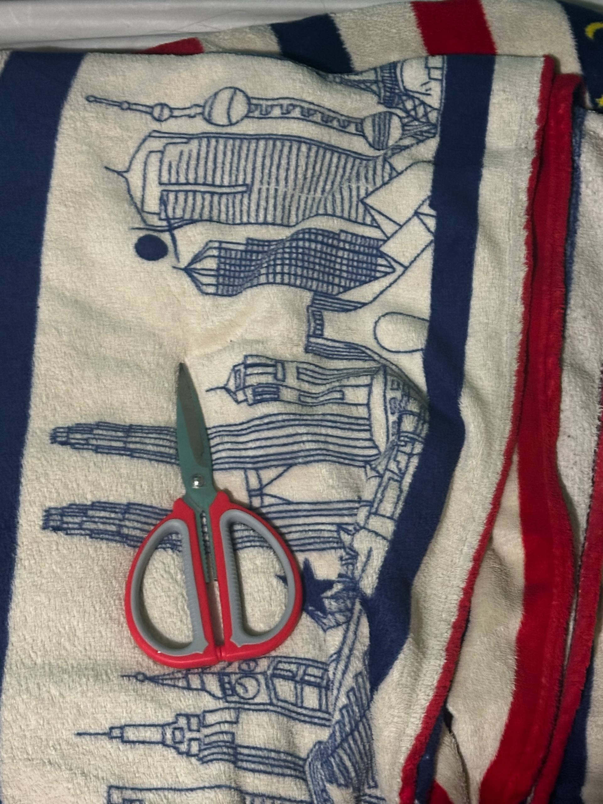

# Child Safety Monitor

A team computer-vision prototype combining hazard detection, a person reference, relative-depth/spatial analysis, a Streamlit interface and Telegram caregiver alerts.

## Project overview

Young children explore by touching and mouthing objects. Button batteries, coins, small toys, medicines and sharp tools are common household items that can cause choking, poisoning or injury. Caregivers can't watch a child every second.

This project is a prototype monitoring assistant. It watches a camera feed, image or video and:

1. **Detects household hazards** with a custom-trained YOLOv8 model (seven hazard groups).
2. **Detects people** with a stock COCO person detector, used as the reference point for proximity.
3. **Estimates relative depth** with Depth Anything V2 Small to tell whether a hazard is at roughly the same depth as the person or far behind or in front of them.
4. **Scores spatial risk** from the image-plane gap, the depth gap and the hazard type, then shows a SAFE, CAUTION, WARNING or CRITICAL level in a Streamlit dashboard.
5. **Alerts caregivers** through Telegram when risk stays high, with duration and cooldown controls to limit repeated messages.

## Team and Contributions

**Team:** AAI3001 — Lab P1, Group 1

| Team Member | Admin Number | Contribution |
|:---:|:---:|:---|
| Ee Chew Fong Olivia | 2102743 | Streamlit interface, camera and image/video testing, Telegram alerts and application integration |
| Thet Htar San | 2502046 | Streamlit interface, camera and image/video testing, Telegram alerts and application integration |
| Teng Tze Hui | 2502437 | Dataset preparation, annotation validation, augmentation, model training, experiment evaluation and model-results documentation |
| Fujita Ayumi | 2502515 | Spatial analysis, proximity calculations, risk scoring and spatial integration |
| Low Yi Hang Nicholas | 2500831 | Spatial analysis, proximity calculations, risk scoring and spatial integration |

**Shared contributions:** system integration, testing, project discussions and report review.

## Documentation

| Guide | What it covers |
|:---:|:---|
| [UI and application guide](docs/UI_GUIDE.md) | Installation, camera controls, image/video testing, spatial/depth integration, Telegram and deployment |
| [Model experiments, results and limitations](docs/MODEL_RESULTS.md) | Baseline and six experiments, evaluation protocol, selected configuration, findings, limitations, future work and artifact records |
| [Spatial analysis and integration](docs/SPATIAL_ANALYSIS.md) | Relative box distance, depth sampling, risk formula, temporal handling, tests and seven-class integration gap |
| [Executed notebook](Child_Safety_Hazard_Detection_YOLOv8.ipynb) | Full preparation/training/evaluation code and recorded outputs |

> **Reading the report on GitHub:** the executed notebook is approximately 38 MB and may be too large for GitHub's notebook preview. The [model guide](docs/MODEL_RESULTS.md) is written to stand alone, with readable result tables and figures. Download the notebook and open it in Jupyter or VS Code if you need the full executed cells.

## Dataset

### How the dataset was built

The hazard dataset combines **public online images** and **photographs the team took and labelled**:

#### 1. Public datasets

| Source | What we used it for | Link |
|:---|:---|:---|
| **ChildSUn** (Kaggle) | 5,350 images of objects categorised as safe (toys, baby items, fruit) or unsafe (knives, sockets, scissors, heaters, forks) for children | [kaggle.com/datasets/fairuzkhan002/datasetvgg19](https://www.kaggle.com/datasets/fairuzkhan002/datasetvgg19) |
| **Open Images Dataset V7** | Knives, scissors, kitchen scenes, medicine | [Open Images V7 visualiser](https://storage.googleapis.com/openimages/web/visualizer/index.html?type=all&set=train&c=%2Fm%2F01lsmm) |
| **LVIS** | Knives, scissors, bottles, bottle caps | [platform.ultralytics.com/ultralytics/datasets/lvis](https://platform.ultralytics.com/ultralytics/datasets/lvis) |
| **Pill-bottles** (Roboflow Universe) | Pill bottles | [universe.roboflow.com/mandam/pill-b1ottles-gtnpm](https://universe.roboflow.com/mandam/pill-b1ottles-gtnpm) |
| **Harmful Objects** (Roboflow Universe) | Harmful household objects | [universe.roboflow.com/harmfull-objects/harmful-objects-wmmd](https://universe.roboflow.com/harmfull-objects/harmful-objects-wmmd) |

Each source keeps its own licence and terms of use. Check the linked dataset page before redistributing any images. Only the filenames and split assignments are stored in this repo, not the images.

#### 2. Self-collected photographs

Team members photographed the hazard objects in real homes: on beds, blankets, clutter, floors and tables, under ordinary indoor lighting. These photos add the cluttered, patterned backgrounds and casual phone-camera angles that the public datasets mostly lack, and that a home monitoring camera is likely to see.

<p align="center">
  
  <br><em>Self-collected example: scissors (<code>sharp</code> group) on a patterned blanket, annotated in Roboflow.</em>
</p>

#### 3. Annotation

- **Tool:** the team annotated the self-collected photos in **[Roboflow](https://roboflow.com/)**, drawing a bounding box around each hazard object and exporting the labels in YOLO format.
- **Public images:** labels were converted or relabelled where needed so that every source uses the same 14-class scheme.

The labelled data is organised into **12 category folders**, each with images and YOLO `.txt` annotations.

### Classes

The original annotations use **14 classes**, which are grouped into **7 hazard groups** for the final detector:

| Final ID | Hazard group | Original classes |
|:---:|:---|:---|
| 0 | `battery` | battery |
| 1 | `coin_battery` | coin_battery |
| 2 | `coin` | coin |
| 3 | `small_object` | bottlecap, dice, marble, small_toy |
| 4 | `pen` | pen, pencap |
| 5 | `sharp` | knife, scissors |
| 6 | `medicine` | medicine_syrup, pill_bottle, pill_packet |

Grouping matches the app's alert categories. It is a design choice, not a proven accuracy improvement, and a group prediction cannot tell you the original fine-grained item (for example knife vs scissors).

### Cleaning and splitting

| Step | Result |
|:---|:---|
| Raw images | 18,073 |
| Removed exact duplicates | 923 |
| Removed duplicates with conflicting annotations | 14 |
| Removed empty-label images | 2 |
| **Prepared images** | **17,134** |

- **Leakage control:** near-duplicate photos are grouped by visual hashing, and each photo group stays in a single split.
- **Split:** 11,996 train / 2,570 validation / 2,568 test images (20,184 / 4,370 / 4,173 objects).
- **Training-only additions:** underrepresented classes are oversampled, background (negative) images and object-paste examples are added, and online augmentation varies scale, framing, lighting, blur and noise. Validation and test images are not augmented. Separate *stress* copies of validation and test apply synthetic degradation for robustness evaluation.

Per-image split assignments are in [results/split_membership.csv](results/split_membership.csv). The images themselves are not in Git. See [data preparation details](docs/MODEL_RESULTS.md#why-data-preparation-matters).

## Selected hazard detector

**Experiment 3: YOLOv8s, input size 640, confidence threshold 0.30, detector-only.** It has the highest mAP@50–95 among the six detectors across clean validation, validation stress, clean test and test stress. Clean-test mAP@50–95 is **0.6549**, and test-stress mAP@50–95 is **0.6080**.

Experiment 6 obtains **96.63% crop-validation accuracy**, but adding it to the detector increases missed hazards and false detections. It is retained as an experiment, not recommended for the final operating configuration.

## Known Limitations

### Hazard detection

- **Missed and false detections remain.** At confidence `0.30`, the clean test set had **546 false detections and 469 missed objects across 2,568 images**. Under synthetic stress, false detections fell to **366** but missed objects rose to **721**. These are object-level counts, not caregiver-alert counts.
- **Small objects are the weakest case.** Recall is about 0.65 for objects 16–32 pixels across, compared with 0.92 for objects 64 pixels or larger. Shrinking images to 0.25 scale drops recall from 0.835 to 0.682. Button batteries and coins far from the camera are exactly this case.
- **Some classes are weaker.** Under stress, recall is 0.702 for `pen`, 0.748 for `sharp` and 0.767 for `battery`.
- **Blur, poor lighting and unfamiliar scenes** reduce accuracy.
- **No detections does not mean the scene is safe.**

### Spatial analysis and relative depth

- **Proximity is not a physical distance.** It is the gap between bounding-box edges divided by the person's box height, so it isn't in metres. Posture (sitting, crawling, lying down), a person cut off at the frame edge, camera angle and perspective all change it.
- **Overlapping boxes do not mean contact.** A hazard on a table behind a child can overlap the child's box in 2D.
- **Depth is relative, not metric.** Depth Anything V2 Small gives values per frame, scaled between 0 and 1 (2nd–98th percentile). They aren't centimetres and can't be compared directly across frames, cameras or scenes.
- **Monocular depth has its own failure modes.** It can be wrong on reflective, transparent or textureless surfaces (glass, mirrors, plain floors), and on small objects whose box covers only a few depth pixels. A nearly flat depth map gives a neutral 0.5.
- **Depth sampling is coarse.** Each box's depth is the median of its central 50%. For a person, that may be the torso rather than the reaching hand. For a small or badly fitting hazard box, it may be the background. Depth runs at 252 × 252 to save time, which loses fine detail.
- **The held-object adjustment is a guess.** When boxes overlap and the hazard is nearer the camera, up to 0.30 is subtracted from the depth gap. This value was set by hand, not measured from arm reach.
- **Live depth can be stale.** Depth runs in a background worker. A depth map up to **1.5 s old** is still used for scoring, so in a fast-moving scene it may describe an earlier moment. Older maps fall back to 2D-only scoring.
- **The risk score is hand-tuned.** Hazard weights and the CAUTION/WARNING/CRITICAL distance thresholds were chosen by the team. They aren't learned from data or validated against real injury risk, and detection confidence isn't factored into the score.
- **Smoothing delays changes.** A one-second score hold and a limit on how fast the score can fall reduce flicker. The trade-off is that the displayed level can stay high briefly after the hazard has gone.
- **"Person" doesn't mean "child."** The COCO person detector can't tell age, so adults trigger the same logic. If no person is detected, the score is zero even if hazards are present.
- **No tracking.** All person–hazard pairs are scored each frame and the highest wins. Identities aren't tracked, so the riskiest pair can switch between frames.
- **Seven-class integration gap.** The spatial weights still use the legacy fourteen-class labels, so `small_object`, `sharp` and `medicine` detections are currently **ignored** by risk scoring. The merged `pen` group uses the old pen weight. See the [spatial integration gap](docs/SPATIAL_ANALYSIS.md#seven-class-integration-gap).
- **Not benchmarked.** No labelled real-world spatial dataset, measured-distance ground truth, or false-alert / missed-alert rate has been collected. Spatial errors also add to upstream detection errors: depth can't make up for a hazard the detector missed.

### Dataset and evaluation

- **Test images aren't fully independent.** Visual hashing can miss related scenes (four large candidate groups were skipped), and the images informed earlier versions of the project. The test score is therefore not a fully unseen benchmark.
- **Label quality isn't fully audited.** Format checks confirm labels are readable and well-formed, but they don't prove every visible hazard has a correct, tight box. Public and self-collected images may have been labelled to slightly different standards.
- **Domain gap.** Many public images are close-ups or product shots, which differ from a ceiling- or shelf-mounted monitoring camera.
- **Synthetic stress isn't real conditions.** Stress transforms reuse the same photos, so they don't replace testing on new homes, cameras and lighting.
- **No empty scenes.** The evaluation has no labelled empty scenes, so the caregiver false-alarm rate is unknown.

### Whole system

The model metrics don't validate the complete live camera → detection → depth → risk → Telegram pipeline. End-to-end latency, alert accuracy and behaviour in real homes haven't been measured. See [detailed model failures and limitations](docs/MODEL_RESULTS.md#failure-analysis-and-practical-consequences) and [spatial limitations and next steps](docs/SPATIAL_ANALYSIS.md#limitations-and-next-validation-steps).

## System scope and integration status

```text
Camera/image/video -> trained hazard detector ----+
                  -> COCO person detector --------+-> relative spatial assessment -> UI / optional alerts
                  -> relative-depth estimation --+
```

The person detector does not establish age. Relative proximity is not a distance measurement in metres, and absence of detections is not proof of safety.

**Integration work remains:** the selected model outputs seven hazard groups, while the current app spatial weights still use the legacy fourteen-class labels. The spatial filter currently excludes `small_object`, `sharp` and `medicine`; the merged `pen` group retains the old pen weight. See the [spatial integration gap](docs/SPATIAL_ANALYSIS.md#seven-class-integration-gap) before relying on risk levels. Model evaluation does not validate the complete live camera/depth/alert pipeline. App code is unchanged by this documentation update.

## Quick start

```powershell
python -m venv .venv
.\.venv\Scripts\python.exe -m pip install -r requirements.txt
.\.venv\Scripts\python.exe -m streamlit run app.py
```

Obtain the selected checkpoint separately and place it at `weights/final_best.pt`, or configure `HAZARD_MODEL_PATH`. Weights are ignored by Git. Without the trained checkpoint, the app uses its stock-model demo/fallback as described in the [UI guide](docs/UI_GUIDE.md).

## Experiment records in this repository

- `results/validation/`: recorded validation scores and threshold sweeps.
- `results/final_test/`: detector, pipeline, class, size and controlled-condition CSV results.
- `results/training_history/`: original epoch histories and run arguments for the completed baseline and Experiments 1–6.
- `results/split_membership.csv`: exported filenames, categories, photo groups and split assignments; no image files.
- `figures/model_training/`: selected evaluation and training figures.
- `configs/model_training/selected_detector.json`: recommended settings and seven-class mapping. This is a record, not an automatically loaded app configuration.
- `configs/model_training/artifact_manifest.json`: source runs, checkpoint hashes, notebook hash and copied-record checksums.

Large datasets, generated image folders and model checkpoints remain outside normal Git tracking. Their locations and access requirements are documented in the [model guide](docs/MODEL_RESULTS.md#artifact-locations-and-verification).
