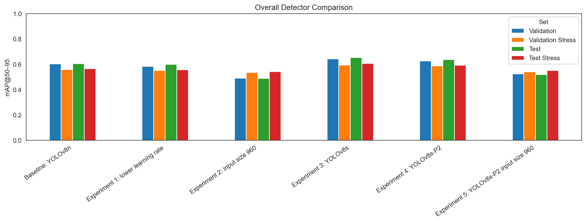
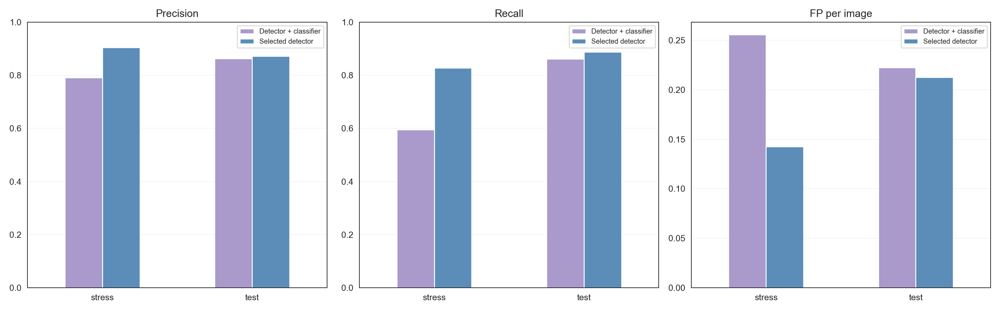
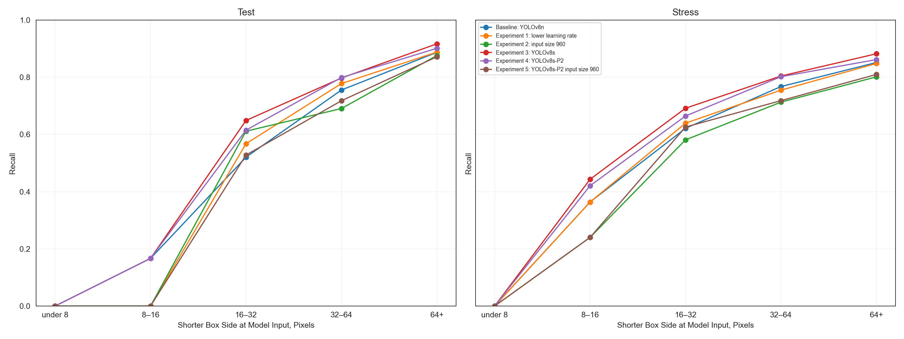

# Model Experiments, Results and Limitations

[Project overview](../README.md) · [UI guide](UI_GUIDE.md) · [Executed notebook](../Child_Safety_Hazard_Detection_YOLOv8.ipynb)

This is the standalone technical account of the model work: the problem, experimental decisions, evidence, limitations and deployment implications. Readers do not need to open the notebook to understand the findings. The notebook remains the implementation and executed evidence record; CSVs and figures provide smaller, directly readable supporting artifacts.

> **Notebook preview:** the executed notebook is approximately 38 MB and contains extensive training logs and embedded outputs. GitHub may fail to render it or report that it is too large to display. Read this guide and the linked CSVs/figures in GitHub; download the `.ipynb` and open it locally in Jupyter or VS Code when the executed cells are needed. A preview failure does not mean the results are missing. Notebook code and saved outputs are unchanged by this documentation update.

## Reading guide

- [Problem and design rationale](#problem-and-design-rationale)
- [Experiment design and selection](#experiment-design-and-selection)
- [Detector results](#detector-results)
- [What each experiment establishes](#what-each-experiment-establishes)
- [Why Experiment 6 is not retained](#why-experiment-6-is-not-retained)
- [Failure analysis and practical consequences](#failure-analysis-and-practical-consequences)
- [Findings and limitations](#findings-and-limitations)
- [Future work and application handoff](#future-work-and-application-handoff)
- [Reproduction and records](#reproduction-and-records)
- [Artifact locations and verification](#artifact-locations-and-verification)

## Problem and design rationale

The detector is intended to supply candidate household hazards to a child-safety monitoring prototype. It must locate objects in a complete image, assign one of the project hazard groups, and provide bounding boxes and confidence scores to downstream spatial analysis. A missed battery or sharp object is therefore consequential even when the overall precision looks high. Detection quality is assessed through recovery of annotated objects and false-box counts, rather than classification accuracy alone.

The model study addresses a specific question: **which tested configuration gives the strongest detection under the same prepared data and training budget, and how does it fail when image conditions change?** It does not train a child detector, estimate physical distance, learn the spatial risk formula or measure caregiver-notification quality. Those are separate components documented in the [spatial guide](SPATIAL_ANALYSIS.md) and [UI guide](UI_GUIDE.md).

### Why seven hazard groups

The fourteen original labels are consolidated into groups that match the application's intended outputs: batteries, coin batteries, coins, small objects, pens/pen caps, sharp objects and medicines. Grouping reduces the number of fine-grained distinctions the final model is asked to make, but the rerun does not contain a controlled fourteen-versus-seven-class experiment. It must therefore be described as an output-design choice, not a demonstrated accuracy improvement.

Grouping also loses information. A `sharp` prediction cannot identify whether the original item was a knife or scissors, and `pen` cannot distinguish a pen body from a pen cap. Downstream risk policies need group-level decisions rather than assuming the original fine-grained label can be reconstructed.

### Why data preparation matters

Preparation checks readability and annotation format, removes redundant exact copies and repeated boxes, converts the class mapping and keeps detected photo groups within one split. The source count decreases from **18,073 to 17,134 images** after removing 923 extra exact copies, 14 conflicting-annotation duplicate images and two empty-label images. This provides a traceable prepared population, rather than silently training on whatever files happen to load.

Near-duplicate grouping reduces leakage risk when similar photographs could otherwise occur in training and evaluation. It does not prove independence: hashes can miss related scenes, and some large candidate buckets are skipped. Likewise, valid YOLO coordinates do not prove that all visible hazards were annotated correctly. Thirty-seven folder/class mismatches were retained for review, because multiple object classes can legitimately appear in a photograph.

### Why balancing and augmentation were retained

The training recipe increases exposure to underrepresented classes through repeated image entries and adds background and object-paste examples. Online augmentation varies apparent scale, framing, lighting and image quality. These choices aim to expose the model to conditions relevant to the prototype, but all final detectors share the recipe. The present comparisons identify differences among model/training configurations; they do not isolate whether balancing, synthetic examples or augmentation itself caused an improvement.

## Experiment design and selection

The source annotations have fourteen classes, mapped to seven hazard groups: `battery`, `coin_battery`, `coin`, `small_object`, `pen`, `sharp`, and `medicine`. The prepared split contains **11,996 training, 2,570 validation and 2,568 test images**, with **20,184 / 4,370 / 4,173 objects** respectively. Photo-group assignments stay within one split. Runs were executed separately, with matching exported split membership.

All six detectors use the same prepared data, balancing-plus-extras recipe and augmentation strengths. Training uses AdamW, a cosine schedule, seed 42, batch 8, maximum 40 epochs and patience 15. The baseline learning rate is 0.0005. The balanced training recipe contains 12,352 original-image entries (including repetitions), 600 background images and 1,500 object-paste images. Repetitions are not new independent images.

| Run | Main change | Input | Primary reference |
|---|---|---:|---|
| Baseline | YOLOv8n, learning rate 0.0005 | 640 | Reference |
| Exp1 | Learning rate 0.0001 | 640 | Baseline |
| Exp2 | YOLOv8n at higher resolution | 960 | Baseline |
| Exp3 | Larger YOLOv8s model | 640 | Baseline |
| Exp4 | YOLOv8s-P2 finer prediction grid | 640 | Exp3 |
| Exp5 | Higher-resolution YOLOv8s-P2 | 960 | Exp4 |
| Exp6 | YOLOv8n crop classifier, learning rate 0.001, 25 epochs | 96-pixel crops | Selected detector alone versus detector + classifier |

P2 uses compatible pretrained-weight transfer and has additional layers requiring training. Comparisons assess the implemented configurations under the shared budget, not architecture in isolation.

**Selection protocol:** choose the detector by clean-validation mAP@50–95. On validation, choose the confidence threshold with fewest false boxes per image among tested thresholds meeting overall recall >= 0.85. Exp3 with confidence 0.30 meets that validation target. Classifier rejection thresholds are also evaluated on validation; none meets the target, so 0.20 is provisional. Test data assess the fixed configurations, not a new threshold search.

## Detector results

All numbers below are **mAP@50–95**, higher is better.

| Model | Validation | Validation stress | Test | Test stress |
|---|---:|---:|---:|---:|
| Baseline | 0.6032 | 0.5585 | 0.6052 | 0.5662 |
| Exp1 | 0.5836 | 0.5526 | 0.5996 | 0.5565 |
| Exp2 | 0.4909 | 0.5364 | 0.4893 | 0.5437 |
| **Exp3** | **0.6441** | **0.5945** | **0.6549** | **0.6080** |
| Exp4 | 0.6279 | 0.5880 | 0.6382 | 0.5929 |
| Exp5 | 0.5248 | 0.5405 | 0.5193 | 0.5518 |

Source: [final model comparison](../results/final_test/final_model_comparison.csv). Increasing model capacity is the only tested change improving this metric against its intended reference across all four sets. Exp3's clean-test gain over baseline is **4.97 percentage points**. P2 at 640 is second-best overall; higher resolution and lower learning rate do not improve aggregate mAP under this recipe.

mAP is supplied by YOLO's evaluator. The following operating-point results use separate class-aware, one-to-one matching at IoU 0.50 and detector confidence 0.30. These values need not equal YOLO's automatically reported precision/recall during training validation.

## What each experiment establishes

### Baseline and Experiment 1: learning-rate sensitivity

The baseline establishes what the smaller YOLOv8n can achieve with the shared recipe. Experiment 1 reduces only its initial learning rate from 0.0005 to 0.0001. Its training losses still decline and validation performance stabilises, so the experiment is a completed learning run rather than a training failure. However, the small validation recall gain is accompanied by lower precision and mAP. Clean-test mAP declines from **0.6052 to 0.5996**. Under this fixed budget, slower initial updates do not yield the desired detection benefit; the experiment does not show what would happen with a separately tuned longer schedule.

### Experiment 2: more input pixels are not sufficient

YOLOv8n is trained and evaluated at 960 rather than 640 pixels. The complete higher-resolution configuration is being compared: it changes both training and inference scale. Clean-test mAP falls to **0.4893**, approximately **11.59 percentage points below the baseline**. This is evidence against this particular 960-pixel recipe, not proof that increased resolution is intrinsically harmful. Resizing also cannot recreate detail missing in the captured image. Changes to learning schedule, resource budget or data quality would need new experiments, not an explanation inferred from the current curves.

### Experiment 3: model capacity provides the clearest gain

Replacing YOLOv8n with YOLOv8s while keeping 640-pixel input improves mAP against the baseline on all four sets. Test mAP rises to **0.6549** and test-stress mAP to **0.6080**, gains of **4.97 and 4.18 percentage points** respectively. This consistency supports the validation-selected configuration. It is still a single run per model, so the study does not establish a distribution of performance across random seeds or a statistically significant advantage.

### Experiments 4 and 5: a small-object-oriented design still needs evidence

Experiment 4 introduces the P2 prediction grid with YOLOv8s at 640 pixels. Its overall scores are second-best, but below plain YOLOv8s: **0.6382 test mAP versus 0.6549**. Some individual class/bin measurements can favour P2, yet this does not establish an overall benefit or justify selecting it against the predefined criterion. Compatible pretrained layers are transferred and additional layers require training, so architecture and its implemented training initialisation must be considered together.

Experiment 5 raises P2 input resolution to 960 and obtains **0.5193 test mAP**, a decline of **11.89 percentage points** relative to Experiment 4. The two higher-resolution experiments therefore do not support increasing resolution as the next deployment step under this recipe. The more useful next investigation is to examine missing detail, annotations and representative small-object data before assuming an input-size increase will solve the problem.

### Why selection happens before test evaluation

Exp3 is selected on clean-validation mAP, then its confidence threshold is selected using validation predictions. At confidence **0.30**, validation recall is approximately **0.866** and false boxes per image are **0.234**. Raising the threshold to 0.40 gives fewer false boxes but recall falls to approximately 0.829, below the project's 0.85 target. This makes 0.30 a transparent operating trade-off, not an arbitrary default or a threshold chosen after inspecting test outcomes.

The target is a project constraint, not a validated safety standard. It applies to aggregate validation recall. It cannot guarantee recall for an individual class, a moving camera or an unseen household scene. The test results assess how that fixed decision transfers.



The chart visualises the recorded comparison. Some 960-pixel models score higher on the transformed set than the clean set; altered scale/composition and annotation filtering mean this is not evidence that degradation generally improves detection.

## Why Experiment 6 is not retained

The classifier's **96.63% accuracy** measures labelling of supplied validation crops. It is not full-image detection mAP and cannot be directly compared with Exp3's mAP. A classifier cannot recover hazards absent from detector proposals.

| Evaluation | Method | Precision | Recall | F1 | FP | FN |
|---|---|---:|---:|---:|---:|---:|
| Clean test | Exp3 alone | 0.872 | 0.888 | 0.879 | 546 | 469 |
| Clean test | Exp3 + classifier | 0.863 | 0.861 | 0.862 | 571 | 578 |
| Stress | Exp3 alone | 0.904 | 0.827 | 0.864 | 366 | 721 |
| Stress | Exp3 + classifier | 0.791 | 0.595 | 0.679 | 656 | 1691 |

Source: [pipeline comparison](../results/final_test/detector_pipeline_comparison.csv). Adding the classifier introduces **109 additional missed objects and 25 additional false detections on clean test**, and **970 additional misses and 290 additional false detections under stress**. It reclassifies proposals as well as rejecting them; changing a correct class to an incorrect one can create both an FP and an FN. Detector-only operation is supported under these measured settings. Crop/proposal distribution differences are plausible contributors but are not proven causes. Other detector–classifier pairings were not exhaustively tested.

### What the crop classifier actually measures

The classifier learns from crops around ground-truth boxes, with a background class and crop-level augmentation. The detector pipeline instead supplies predicted boxes, which may be off-centre, include neighbouring items or contain little usable target detail. Strong accuracy on supplied crops therefore addresses one subproblem, not whether the complete system finds and correctly labels every object in a scene.

The evaluated pipeline keeps the detector's boxes and scores, replaces accepted class labels with the classifier's predicted group, and rejects proposals classified as background or below the classifier threshold. It has no mechanism to create a missing detector proposal or repair box localisation. Its rejection and reclassification errors can outweigh corrections.

No tested classifier threshold met the validation recall target. The displayed 0.850 recall at thresholds 0.20 and 0.35 is rounded: **3713 / 4370 is approximately 0.84966**. The provisional 0.20 threshold was nevertheless carried into the documented test comparison to measure the pipeline, not presented as meeting the requirement. Clean-test performance is relatively close to the detector alone, but both false detections and misses move in the wrong direction; stress exposes a substantially larger loss. This is why Exp6 is retained as a documented negative result rather than silently omitted or selected on its headline accuracy.



## Failure analysis and practical consequences

### Misses persist despite strong aggregate mAP

At confidence 0.30, Exp3 detects **3,704 of 4,173 objects** on clean test and misses 469. Under stress it detects 3,452 and misses 721. Precision increases under stress while recall decreases, illustrating why a higher precision alone cannot be interpreted as a safer detector. The system issues fewer incorrect boxes but also recovers fewer actual hazards.

The object-outcome analysis identifies **214 low-confidence and 132 no-useful-proposal cases on clean test**, rising to **359 and 237 under stress**. Low-confidence cases suggest a threshold trade-off, while absence of a useful cached proposal cannot necessarily be repaired by lowering the final threshold. Wrong-class and poor-localisation examples show additional patterns. These are operational categories under matching rules, not a diagnosis of the physical cause of each error; predictions below the cache floor of 0.05 are unavailable.

### Difficult classes need targeted attention

Pen recall is the lowest of the seven groups for the selected model, decreasing from **0.755 to 0.702** under stress. Sharp objects and batteries also remain weaker than several other groups. More general training data alone may not resolve the patterns; the next data collection should include the relevant views, occlusions, clutter and confusing backgrounds, with annotation review. The existing figures identify priorities, not proof that a particular augmentation or class-weight change will fix them.

### Small-object findings must retain their sample counts

For Exp3, clean-test recall is **0.649 at 16–32 input pixels**, **0.797 at 32–64**, and **0.917 at 64+**, using the shorter bounding-box side. Only six clean-test objects fall in the 8–16-pixel group and three under 8, so apparent extremes there are uncertain. Pixel groups are model-input measurements, not centimetres or camera distances. The same original object can move between bins at 640 versus 960; those groups are not matched populations across resolutions.

The one-factor condition study uses the same **150 source images**, largely retaining 236 objects (235 after rotation). Shrinking to 0.25 gives the largest recall loss: Exp3 falls from **0.835 to 0.682** and false boxes per image rise from approximately **0.113 to 0.220**. Some moderate transformations produce equal or higher scores on this subset. This supports a specific limitation around severe loss of apparent size, not a universal claim that every brightness or blur change reduces accuracy.



## Findings and limitations

| Finding / limitation | Evidence and scope |
|---|---|
| Small objects remain difficult | Exp3 clean-test recall is 0.649 at 16–32 input pixels versus 0.917 at 64+ pixels (shorter box side). The under-8 and 8–16 clean-test groups have only 3 and 6 objects, so conclusions there are uncertain. |
| Degraded conditions reduce recovery | Exp3 stress recall is 0.827 versus 0.888 on clean test; meeting the validation target does not guarantee stress recall >= 0.85. |
| Uneven hazard-class recall | Pen, sharp and battery stress recall are 0.702, 0.748 and 0.767. An aggregate target does not guarantee every class meets it. |
| Severe shrinkage is a major weakness | On the controlled 150-image subset, Exp3 recall falls from 0.835 control to 0.682 at scale 0.25. This is a synthetic scale change, not a measured physical distance. |
| Dataset differs from live monitoring | Public and self-collected photographs do not establish performance in continuous household-camera scenes. Synthetic stress images are derived from existing photos, not independent camera data. |
| Earlier test exposure | Test photographs informed earlier project development, even though they are excluded from training in this final split. This is not a completely unseen benchmark for the whole project. |
| Annotation and duplicate uncertainty | Format checks cannot ensure complete/correct labels. Grouped visual hashes reduce leakage risk but may miss related photos; four large candidate buckets were skipped. |
| Synthetic-training limits | Pasted crops can retain background and visible boundaries. Background crops rely on complete source annotations. |
| Different transformed populations | Visibility filtering and transformations can change evaluated annotations. Size bins at 640 versus 960 contain different object populations. Stress improvements in a bin are not proof degradation helps. |
| Single-run evidence | One seed and fixed budget per configuration; no multi-seed confidence intervals. The shared recipe does not isolate augmentation's benefit. |
| No measured physical operating range | Pixels and synthetic brightness/rotation do not establish metres, lux limits or true 3D viewpoint robustness. |
| False boxes are not parent alerts | No labelled-empty evaluation scenes were available; empty-scene alarm rates are unavailable, not zero. Temporal alerts need separate evaluation. |
| Application validation remains | Live capture, depth-map age, latency, grouped-class spatial handling and alert behaviour need end-to-end checks. No detection does not prove safety. |

Evidence: [class results](../results/final_test/selected_model_classes.csv), [size results](../results/final_test/recall_by_pixel_size.csv), [controlled conditions](../results/final_test/controlled_condition_results.csv), and notebook Sections 8–10. The spatial/depth timing limitations in the UI guide are application observations, separate from these detector measurements.

## Future work and application handoff

1. Review difficult-class annotations and confusing/missed examples; collect representative live-camera data and independently labelled empty scenes.
2. Evaluate the same objects under recorded camera distance, lighting, placement and capture resolution; measure end-to-end delay and alert outcomes.
3. Repeat key configurations across seeds before treating small differences as conclusive.
4. Investigate classifier proposal crops, rejected true hazards and reclassification errors before further pipeline use.
5. Integrate `final_best.pt` with input 640 and confidence 0.30. Preserve model class names, keep Exp6 disabled, and review the legacy spatial mapping for grouped `small_object`, `sharp`, `medicine` and `pen` labels. A group-level prediction cannot recover the original fine-grained class.

The current `modules/spatial.py` risk weights use fourteen legacy classes. Its hazard filter requires membership in that mapping, so grouped `small_object`, `sharp` and `medicine` detections are currently excluded from spatial risk scoring; the default weight does not rescue them after that filter. The merged `pen` group retains a pen-only weight. See the [spatial integration assessment](SPATIAL_ANALYSIS.md#seven-class-integration-gap). The existing alias for `medicine_syrup` does not handle grouped `medicine`. This documentation update records the mismatch without changing application behaviour or choosing new risk weights.

## Reproduction and records

The root notebook is a compilation of separate sessions with preserved outputs, not proof of one uninterrupted Run All. Reproduction requires the raw dataset for training and the saved bundle for final evaluation. The bundle loader reloads historical checkpoints; retraining earlier cells does not automatically replace that bundle.

The final evaluation log records **Python 3.13.16, Ultralytics 8.4.198, Albumentations 2.0.8, Torch 2.11.0+cu130 and Tesla T4**. The allocated accelerator was T4 x2 but code used device 0. This differs from the local app's Python/dependency context; the root requirements file is preserved, not claimed to be an exact Kaggle lockfile.

Per-run histories and original `args.yaml` files are under [training_history](../results/training_history/). Arguments can contain historical Kaggle paths or framework-specific YAML tags and are evidence, not portable configs to load blindly. [Split membership](../results/split_membership.csv) retains exported filename, category, split and photo-group ID, without image data or source-path columns.

The baseline source session was stopped after completing baseline and Exp1; its partial Exp2 is excluded. Exp2–6 records use their completed standalone sessions. See the [artifact manifest](../configs/model_training/artifact_manifest.json) for session references, hashes and exact local records copied into this repo.

## Artifact locations and verification

| Artifact | Location / record |
|---|---|
| Baseline + Exp1 | [Kaggle baseline notebook, version 8](https://www.kaggle.com/code/oliviaee/cvdl-final-baseline-exp1) — manifest records version 8 and session 369424590 |
| Exp2 | [Kaggle Exp2](https://www.kaggle.com/code/oliviaee/cvdl-exp2) |
| Exp3 | [Kaggle Exp3](https://www.kaggle.com/code/oliviaee/cvdl-exp3) |
| Exp4 | [Kaggle Exp4](https://www.kaggle.com/code/tzehui/cvdl-exp4) |
| Exp5 | [Kaggle Exp5](https://www.kaggle.com/code/tzehui/cvdl-exp5) |
| Exp6 | [Kaggle Exp6](https://www.kaggle.com/code/tzehui/cvdl-final-exp6) |
| Final evaluation | [Kaggle Sections 7–10](https://www.kaggle.com/code/tzehui/cvdl-final-section-7-10) |
| Evaluation input | Private Kaggle Dataset `tzehui/cvdl-output`; bundle root `CVDL_Final_Evaluation_Bundle` |
| Selected checkpoint | Final evaluation output: `CVDL_Final_Evaluation/models/final_best.pt`; copy locally to `weights/final_best.pt` |
| Full failure records and images | Original final evaluation output, including `object_outcomes.csv`, `metrics/` and `evaluation_images/` |

Kaggle pages/datasets may require author-granted access. Page URLs can advance to newer versions; compare source-session records and SHA-256 checksums in the manifest rather than assuming the latest output is identical. Models and datasets are not uploaded by this change. Source image URLs/licences and earlier V2/V3 report citations are not fully supplied in the notebook and still need attribution before final submission.

To verify a downloaded model on Windows:

```powershell
Get-FileHash -Algorithm SHA256 .\weights\final_best.pt
```

Compare the result with the `final_best.pt` entry in the manifest. Existing `weights/`, runtime databases and secrets stay ignored. The executed notebook is around 38 MB, above GitHub's browser upload limit; push it using Git or distribute the executed file separately. Do not clear its saved results just to upload it.

## References

- [Ultralytics YOLOv8](https://docs.ultralytics.com/models/yolov8/): model family.
- [Ultralytics validation](https://docs.ultralytics.com/modes/val/): mAP and evaluator documentation.
- [Albumentations](https://albumentations.ai/docs/): image and bounding-box transformations. Current documentation may describe newer releases; recorded versions above govern this experiment.
- Internal evidence: notebook Sections 6–10 and the linked CSVs/training histories. Original public-image sources and earlier-project bibliographic details remain to be completed; no missing source attribution has been invented.
