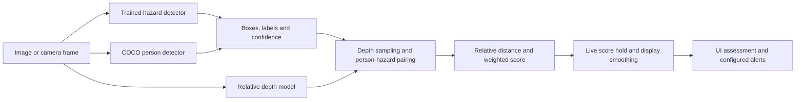

# Spatial Analysis, Relative Depth and Risk Scoring

[Project overview](../README.md) · [Model findings](MODEL_RESULTS.md) · [UI guide](UI_GUIDE.md)

This guide documents the current spatial implementation and its assumptions. It explains how detector outputs become a relative proximity score, how depth and temporal handling change that score, and what remains unvalidated. It is based on repository source, not on a new physical-camera experiment. Model mAP and crop-classification results are described separately in the model guide.

## Purpose and boundary of the component

Recognising a hazardous object does not by itself determine whether a person is near it. Spatial analysis combines detected person and hazard boxes with optional relative depth, producing a score and an explanation for the interface. It is a hand-designed heuristic. It does not estimate contact, reachability, injury probability or physical distance, and it does not identify a detected person's age.

The code uses the label `person` as the child reference. Names such as `children` and messages saying “child” are application terminology, not evidence of an age-specific model. Missed people or hazards propagate into the spatial result; a correct formula cannot recover missing detector inputs.

## Data flow and component responsibilities



| Source | Responsibility |
|---|---|
| [`modules/detector.py`](../modules/detector.py) | Load the trained checkpoint and produce hazard boxes with model class names; default hazard confidence 0.30 |
| [`modules/classifier.py`](../modules/classifier.py) | Combine trained hazard and stock person detections; call spatial analysis; map score to UI level |
| [`modules/depth_estimator.py`](../modules/depth_estimator.py) | Run Depth Anything V2 Small, sample object regions and normalise relative depth |
| [`modules/spatial_pipeline.py`](../modules/spatial_pipeline.py) | Shared detection conversion, demo/person thresholds and maximum live-depth age |
| [`modules/spatial.py`](../modules/spatial.py) | Pairwise distance, depth adjustment, hazard weights, proximity zones, raw risk score and score hold |
| [`app.py`](../app.py), `TimedClassifier` | Background live depth, freshness fallback and temporal display behaviour |

The class name `HazardSpatialClassifier` refers to app integration; it is **not the Experiment 6 crop classifier**. The recommended trained-model configuration uses Exp3 alone for hazard detection, with the separate person/depth/spatial components still available.

`get_classifier()` chooses the trained pipeline when a checkpoint is found. Without it, the stock demo recognises person and stock-supported hazards such as knife/scissors; it is not equivalent to running the final seven-group detector. In the trained path the person model is YOLOv8n; the stock demo uses YOLOv8s. These are separate from the selected YOLOv8s hazard checkpoint.

## Input contract

Each `Detection` carries a label, confidence, pixel-coordinate box `(x1, y1, x2, y2)` and optional relative depth. Detections without a box are excluded. Labels are lowercased and spaces changed to underscores. The spatial analyzer selects people by `CHILD_LABELS = {"person"}` and hazards by membership in `DANGER_WEIGHTS`.

All person-hazard pairs are evaluated and the highest pair score is returned. This avoids selecting only the most confident person and missing a hazard near another person. It is not object tracking, and the selected pair can change between frames.

If there is no person, or no recognised hazard, the raw analyzer returns zero with an explanatory message. That is a limitation of available inputs, not a declaration that the physical scene is safe. An unknown/grouped label can trigger the same absence of recognised hazards; see the integration gap below.

## Image-plane proximity

Distance is the shortest separation between the bounding-box edges. For two boxes, the horizontal and vertical gaps are clipped at zero, then combined with Euclidean distance. Overlapping or touching boxes have zero edge separation.

```text
dx = max(hazard_left - person_right, person_left - hazard_right, 0)
dy = max(hazard_top - person_bottom, person_top - hazard_bottom, 0)
pixel_gap = sqrt(dx^2 + dy^2)
planar_distance = pixel_gap / person_box_height
```

Normalising by person height gives a relative unit. For example, a 60-pixel gap beside a 300-pixel-tall person gives 0.20 person-box heights. This reduces sensitivity to uniform image scaling, but not to posture, truncated boxes, perspective or incorrect person localisation. It is not a calibrated reach model, and overlapping 2D boxes do not prove physical contact.

## Relative-depth sampling and adjustment

Depth Anything V2 Small is loaded lazily and reused. The implementation sets depth input dimensions to **252 × 252** for the processing trade-off recorded in the code. No end-to-end speed guarantee follows from that setting.

Depth is sampled as the median of the **central 50% of each box's width and height**, reducing influence from box corners. It is normalised using the same map's **2nd and 98th percentiles**, clipped to [0, 1], with larger values treated as nearer the camera. A nearly flat map gives the neutral value 0.5. These are frame-relative values, not metres and not stable coordinates across different frames.

When both detections have depth, the absolute depth difference adds an extra separation term:

```text
depth_gap = abs(person_depth - hazard_depth)
effective_distance = sqrt(planar_distance^2 + (3.0 * depth_gap)^2)
```

If the boxes overlap and the hazard is nearer the camera than the person reference, the implementation subtracts up to **0.30** from the depth gap before combining it. This heuristic prevents some hand/lap-held foreground objects from being treated as far away solely because the person's body has a different depth. It is an assumed tolerance, not measured arm reach.

Without usable depth, effective distance equals planar distance. For fixed boxes the depth term can only maintain or increase separation and thus maintain or reduce the raw score. Errors in depth can therefore suppress an otherwise close 2D pair. Conversely, planar fallback can overstate proximity when the objects lie at different physical depths. Neither path is established as a guarantee against under-warning in real scenes.

## Raw risk score and displayed levels

For each recognised person-hazard pair:

```text
proximity = max(0, 1 - effective_distance / 3.0)
pair_score = proximity * hazard_weight
raw_score = maximum pair_score across all pairs
```

The returned raw score is rounded to three decimals. Confidence controls which detections reach this stage but is **not multiplied into this formula**. The hazard weights and thresholds are manually specified design parameters, not learned injury probabilities or clinically validated severity measures.

There are two distinct classifications:

| Effective distance (person-box heights) | Geometric zone used in explanation |
|---|---|
| Less than 0.5 | CRITICAL |
| 0.5 to below 1.5 | WARNING |
| 1.5 to below 3.0 | CAUTION |
| 3.0 or more | SAFE / zero proximity |

| Score | UI assessment level |
|---|---|
| Below 0.25 | SAFE |
| 0.25 to below 0.50 | LOW |
| 0.50 to below 0.75 | MEDIUM |
| 0.75 or above | HIGH |

A geometric CRITICAL zone does not automatically imply HIGH: score also depends on hazard weight. For example, a coin battery with weight 1.0 at effective distance 0.20 gives approximately 0.933 and HIGH; a recognised `pen` with weight 0.30 at zero separation gives 0.30 and LOW. These are illustrative calculations from the formula, not observed camera-test results. The low pen weight is especially problematic when the final model's `pen` group also includes pen caps.

The zero/SAFE label is a computational state. It must not be read as certified safety when inputs are absent, detections fail, labels are filtered or the model misses small hazards.

## Live timing, fallback and score persistence

Image/video test calls can compute depth from the frame being assessed. Live monitoring uses a background worker with one outstanding depth job, so detection can continue while depth processing is slower.

The current `TimedClassifier` measures map age from the **submission time of its source frame**. A completed depth map is used only while its age is at most **1.5 seconds**, and incompatible map dimensions are rejected by the delegate. Older maps fall back to image-plane-only assessment and receive an explicit status message. The UI may still display an old map with its age; displaying it does not mean it was used for scoring. Even a map within the age limit can describe an earlier moving scene.

Live scores rise immediately but persist through brief drops using a **one-second `ScoreHold`**, followed by an additional limit on how quickly the displayed score can fall. The displayed level can therefore outlast the current frame's raw result. This reduces flicker but introduces persistence and clearance delay; it is not tracking or proof a hazard remains present. Alert behaviour depends on additional UI duration/cooldown settings, not just the raw spatial zone.

## Seven-class integration gap

**This is a current implementation gap, not only a documentation mismatch.** The selected checkpoint outputs seven groups, while `DANGER_WEIGHTS` contains the original fine-grained hazard names. `SpatialAnalyzer.assess()` filters hazards to that dictionary before applying weights. Therefore the default weight does not automatically cover an unrecognised group.

| Final detector label | Current spatial handling | Consequence |
|---|---|---|
| `battery` | Recognised; weight 0.85 | Included in pairwise scoring |
| `coin_battery` | Recognised; weight 1.0 | Included |
| `coin` | Recognised; weight 0.8 | Included |
| `pen` | Recognised; weight 0.3 | Included, but same low weight now covers pen caps |
| `small_object` | Not in dictionary | Excluded from spatial hazard scoring |
| `sharp` | Not in dictionary | Excluded from spatial hazard scoring |
| `medicine` | Not in dictionary | Excluded from spatial hazard scoring |

The existing `medicine_syrup -> liquid_medicine` alias handles an older fine-grained label, not the final `medicine` group. UI hazard-presence checks also use the dictionary, so grouped labels can be present in detector outputs without being treated as recognised hazards downstream.

Before relying on the trained pipeline, the team must agree on group-level risk policies, align spatial and UI handling, add tests for all seven final labels and verify real model-to-app outputs. This documentation does not select new risk weights or change behaviour. The detector results establish neither that mapping nor the safety of the integrated system.

## Existing checks and what they do not establish

| Record | Coverage visible in source |
|---|---|
| [`test_hazard_pipeline.py`](../modules/tests/test_hazard_pipeline.py) | Stand-in detector/person outputs, near/far behaviour, absent person, depth differences |
| [`test_depth_logic.py`](../modules/tests/test_depth_logic.py) | Controlled depth cases, fallback, multi-person pairing and foreground-held-object behaviour |
| [`test_distance_demo.py`](../modules/tests/test_distance_demo.py) | Manual geometry examples and a direct analyzer example |
| [`live_spatial_test.py`](../modules/tests/live_spatial_test.py) | Interactive spatial/depth diagnostic script |

These sources show the intended logical checks. They do not provide a labelled real-world spatial benchmark, calibrated centimetre error, reachability accuracy or missed/false-alert rate. Their presence is not a fresh passing test result; tests were not rerun for this documentation-only update. The stand-in hazard tests include legacy labels and do not establish complete seven-group integration.

For an appropriate local environment, the existing automated checks can be invoked with:

```powershell
python -m pytest modules/tests/test_depth_logic.py modules/tests/test_hazard_pipeline.py -q
```

## Limitations and next validation steps

1. **Finish label integration first.** Verify each of the seven detector labels produces the agreed spatial treatment; include the pen-cap grouping decision and UI presence checks.
2. **Define a spatial reference task.** Decide whether a positive case means close in the image, same depth, within reach or actual contact. These are different targets; the current formula addresses relative box/depth separation.
3. **Collect recorded camera cases.** Fix camera height/resolution, record object/person positions, include foreground/background overlap, occlusions, truncated people, multiple people and no-person/empty scenes. Physical measurements must be observed, not inferred from box heights.
4. **Assess timing as well as geometry.** Measure capture-to-detection, depth age, displayed-score persistence and notification delay on deployment hardware, including stale/depth-failure fallback.
5. **Calibrate policies against evidence.** Report detection failures separately from spatial errors and alert-policy errors. Evaluate near/far mistakes and false/missed warnings before changing hand-set weights or thresholds.

Model evaluation already shows small-object and degraded-image misses. Those limitations remain upstream risks here. Relative depth can help distinguish some projected overlaps but cannot compensate for an undetected hazard, incorrect class or badly localised person. No-detection and SAFE outputs must be interpreted with these limits visible.
